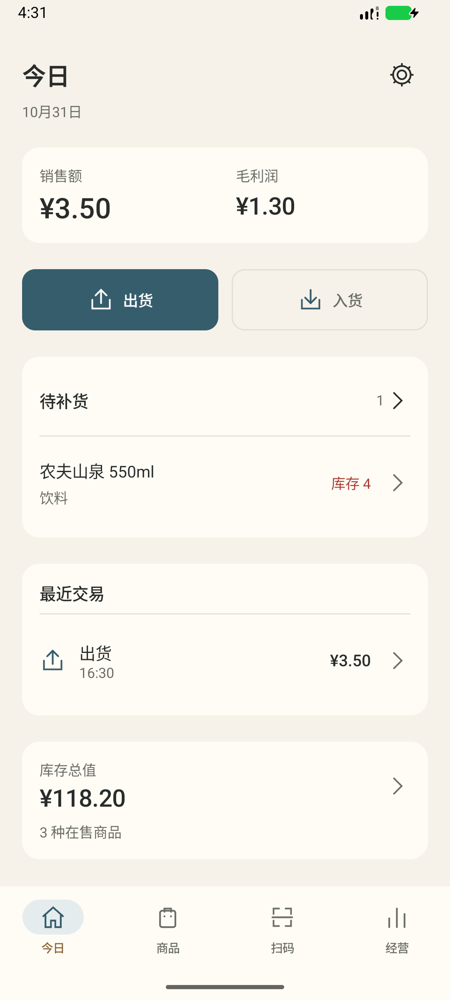
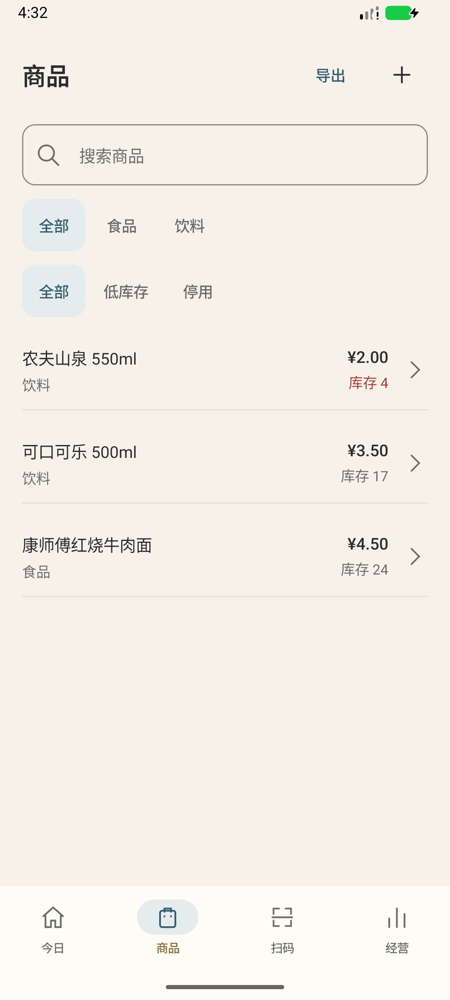
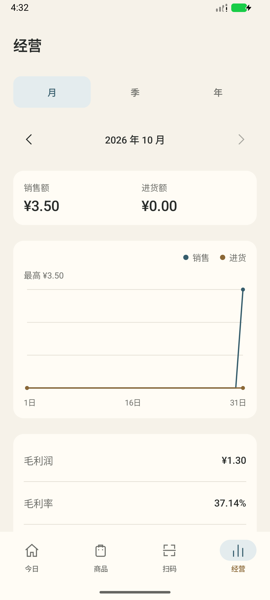

<p align="center">
  
</p>

<h1 align="center">铺记</h1>

<p align="center">为小卖部设计的离线 Android 进销存工具。无需注册或服务器，商品、库存和交易都保存在本机。</p>

<p align="center">
  
  
  
</p>

<p align="center"><sub>今日 · 商品 · 经营</sub></p>

## 2.0 升级

- 米白界面、统一的小字号与轻量列表，今日、商品、扫码、经营四栏；支持深色和系统大字体。
- 新的色片拼贴小店图标，包含 Android 自适应及单色资源。
- 多商品连续扫码、手工条码、搜索选货、数量/单价/备注修改、本地草稿。条码持续停留时不会反复加件，移开后可再次识别。
- 商品详情、停用与恢复、库存变动历史。资料编辑不再直接改库存。
- 期初库存、盘点、报损、原单部分退货和冲正；原始单据不直接修改或删除。
- 移动平均库存成本、成交成本快照、净销售与净采购、毛利润、进销差额，报损/盘亏和估值差额单列。
- 完整备份与恢复、商品 CSV 预览导入、库存/流水 CSV 导出。流水搜索和日期/类型条件同样用于导出。

此仓库同时保留 `harmony/` 历史工程。本轮只升级 Android，不同步修改鸿蒙版。

## 日常使用

1. 在商品页创建商品；期初库存会单独留痕，不计采购支出。也可在入货时扫描未知条码建档，随本单一起提交。
2. 从今日进入出货或入货；将商品加入清单，核对数量和价格后确认。切换模式会提示保护现有清单。
3. 商品详情提供盘点、报损和库存历史；资料编辑只改名称、分类、建议价格等。
4. 从经营进入流水，点击单据查看明细，按原单选择退货或生成冲正。成功后返回流水，失败保留输入。
5. 在设置中定期保存完整备份到手机外的网盘或电脑。CSV用于查账或商品录入，不能替代完整备份。

## 数据口径

- 金额用整数分，库存用整数件；不支持称重和箱件换算。
- 库存总成本按实际进货和现存数量分摊，最后一件消耗剩余尾差。编辑建议进价不改历史利润。
- 销售退货按原售价和成交成本回退，累计数量与成本不超过原单；进货退货的业务金额按原单，库存按当前成本减少，差额另记。
- 错单通过关联冲正处理；存在未处理关联退货或会出现负库存时，系统会拒绝冲正。
- 毛利润不是净利润；进销差额是净销售减净采购，不是银行或现金账户余额，不含房租、人工等费用。
- 旧版已有成本快照保留；v1估算回填和v2来源不明确分别标注。现存库存迁移估值不伪造成历史采购。

## 备份与恢复

完整备份为 `.puji.json`，包含四张业务表的所有字段、版本和校验信息及扫码反馈设置。恢复先验证内容与关联，再在事务中替换当前账本；失败回滚。恢复会清空未提交草稿。

每次冷启动已有账本时尝试保存当日的本机自动副本（同日不重复），轮换最近三个日期；替换前另保留一个回退副本，可在设置中检查后恢复。本机副本不防卸载或设备丢失；请仍将完整备份保存在应用外。永久清除会删除账本、草稿和本机副本，外部导出文件不受影响。

商品导入使用应用提供的模板或库存导出表。先预览并修正错误，再确认导入；同条码的现有商品只更新资料，保留库存、成本和停用状态；新商品的初始库存生成期初记录。批量导入整体成功或回滚。

## 旧版升级

- 包名 `cn.puji.app`；Android 8.0 / API 26 及以上。
- 源码版本 `2.0.1`，versionCode `7`，数据库版本 `3`。
- 覆盖安装必须与旧 APK 证书一致；不要通过卸载旧版处理签名冲突。升级前先导出库存和流水，条件允许时另存完整数据副本。
- 当前 release 沿用项目原有开发签名方式，不应直接视作应用市场发行签名。
- 业务与界面验收见 [2.0 验证记录](docs/TESTING-V2.md)，图标分发兼容修复见 [2.0.1 验证记录](docs/TESTING-V2.0.1.md)。设计预览不等同于实际运行截图。

## 开发与验证

使用 JDK 21（或兼容的 JDK 17）、Android SDK 36.1 与工程所列依赖：

```bash
./gradlew --no-daemon --max-workers=1 testDebugUnitTest lintDebug assembleRelease
./gradlew --no-daemon --max-workers=1 connectedDebugAndroidTest
```

设备测试应明确指定本任务设备，避免修改其他任务的模拟器。纯 Kotlin 规则可在已有本机编译器缓存环境使用 `python3 scripts/check-domain.py --all`；它不替代 Android 编译和设备数据库测试。

未来多设备协作预留了稳定 UUID 和仓库边界，本版没有联网同步。供应商、赊账、支付、打印和多门店不在本轮范围。

## 开源参考

业务建模参考 [Open Source POS](https://github.com/opensourcepos/opensourcepos) 的销售、进货和交易留痕，以及 [InvenTree](https://docs.inventree.org/en/stable/stock/tracking/) 的库存变动跟踪。界面为原生 Compose 实现，不内嵌这些项目的 Web 服务。项目为 MIT License，第三方说明见 [THIRD_PARTY_NOTICES](docs/THIRD_PARTY_NOTICES.md)。
